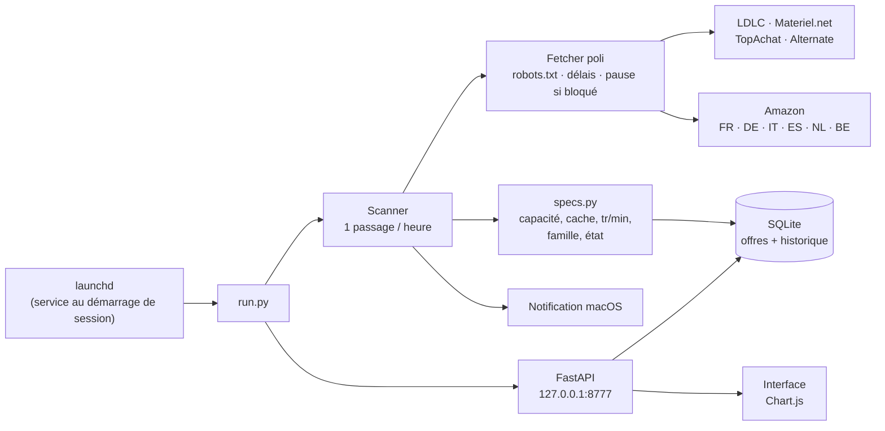

<div align="center">

# 🔎 HDD Hunter

**Le guetteur de bonnes affaires sur les disques durs serveur, 24 h/24.**

Seagate Exos · WD Ultrastar / Gold · Toshiba MG — neufs ou reconditionnés, livrés en France, avec retour et garantie.


</div>

---

## ✨ Ce que fait HDD Hunter

- 🕐 **Tourne en continu** en arrière-plan (service macOS) : un passage par heure sur chaque boutique.
- 🎯 **Filtre selon tes critères** : 7200 tr/min, cache 256–512 Mo, 16–28 To, 500–750 € *livrés en France* (tout est réglable dans l'interface).
- 🌍 **Compare les pays** : Amazon FR, DE, IT, ES, NL, BE — le prix est converti en **prix livré France** (la TVA locale est remplacée par la TVA française, comme le fait la boutique à la commande).
- ♻️ **Neuf ou reconditionné ?** détecté en 3 niveaux (titre, référence du disque, fiche produit et avis clients), avec le vendeur affiché.
- 📈 **Historique des prix** de chaque URL, même retirée de la vente, avec courbes et export CSV.
- 🔔 **Notification macOS** groupée à chaque nouvelle offre ou baisse de prix de plus de 3 %.
- 🤝 **Bon voisin** : respecte `robots.txt`, 5 à 10 s entre deux requêtes, pause automatique si un site dit stop. Aucun contournement de protection anti-robots.

### L'interface (http://127.0.0.1:8777)

| Section | Contenu |
|---|---|
| **Tuiles** | offres qui correspondent, moins chère, meilleur €/To, dernier passage |
| **Critères** | prix, capacité, cache, vitesse, classe (serveur / NAS pro), état, interface SATA / SAS |
| **Graphiques** | meilleur prix par capacité dans le temps · historique d'une offre · meilleur prix par site |
| **Offres** | tableau triable, badge Neuf / Reconditionné (survol = raison), vendeur, pays |
| **Historique des URL** | prix de départ, actuel, min, max, évolution, mini-courbe, recherche, export CSV |
| **Sites** | état de chaque boutique (ok / vide / bloqué), activer / désactiver |
| **Liens manuels** | idealo, LeDénicheur, Geizhals, Proshop… (sites qui refusent les robots) |

---

## 🚀 Installer

1. Télécharge **`HDD-Hunter-1.0.0.zip`** dans la [dernière release](../../releases/latest) et dézippe-le (ou clone le dépôt).
2. Dans un terminal, depuis le dossier :

```zsh
./install_service.sh          # crée l'environnement Python, installe et démarre le service
./install_service.sh --awake  # idem + empêche la mise en veille automatique du Mac
open http://127.0.0.1:8777    # l'interface
./uninstall_service.sh        # arrêter et retirer le service (les données restent)
```

Sans service, à la main : `python3 -m venv .venv && .venv/bin/pip install -r requirements.txt && .venv/bin/python run.py --open`

---

## ⚙️ Comment ça marche



1. **Collecte** : chaque boutique a son module (`hddhunter/sources/`) qui lit la page catégorie ou la recherche, puis la fiche produit si le prix n'est pas dans la liste.
2. **Lecture des caractéristiques** (`specs.py`) : capacité, vitesse, interface et famille sont extraites du titre ; le cache est déduit de la famille quand il n'est pas écrit (marqué « ~ » dans l'interface).
3. **Prix livré France** : `prix / (1 + TVA locale) × 1,20` (règles UE de vente à distance). Frais de port Amazon étranger non inclus.
4. **Stockage** : un relevé est ajouté à chaque changement de prix ou de stock, et au moins toutes les 6 h — aucune variation n'est perdue.

### ♻️ Neuf ou reconditionné ?

| Niveau | Source | Exemple |
|---|---|---|
| 1. **Titre** | mots-clés en 6 langues | « refurbished », « generalüberholt », « ricondizionato », « renewed »… |
| 2. **Référence** | les Seagate en `…NM00xC` sont des *factory recertified* | ST16000NM002C, ST24000NM000C, ST26000NM000C, ST28000NM000C |
| 3. **Fiche Amazon** | programme Renewed, description, puis avis clients (≥ 2 avis ou ≥ 25 %) | relue une fois par semaine pour les offres « neuves » proches des critères |

Dans l'interface, **« Reconditionné \* »** signale un état déduit, **« Neuf ⚠ »** un seul avis isolé à vérifier. Survoler le badge affiche la raison.

### 🔒 Sécurité

- L'interface n'écoute **que sur 127.0.0.1** (invisible depuis le réseau).
- Elle **refuse les requêtes venant d'autres sites web** (contrôle des en-têtes `Origin`, `Host` et `Sec-Fetch-Site`) : une page malveillante ouverte dans ton navigateur ne peut ni lire tes données ni changer tes critères, même par *DNS rebinding*.
- Les titres récupérés sur les sites sont passés à la notification macOS **en arguments**, jamais insérés dans un script.

---

## 🗂️ Organisation des fichiers

```
HDD-Hunter/
├── run.py                      lance le scanner (fil de fond) + l'interface web
├── install_service.sh          crée le venv et installe le service launchd (--awake : anti-veille)
├── uninstall_service.sh        retire le service
├── requirements.txt            httpx, beautifulsoup4, lxml, fastapi, uvicorn
├── hddhunter/
│   ├── db.py                   SQLite (offres, historique, passages, alertes) + critères par défaut
│   ├── fetch.py                téléchargement poli : robots.txt, délais, détection de blocage
│   ├── scanner.py              boucle 24/7, enregistrement, alertes, lecture des fiches Amazon
│   ├── specs.py                lecture des caractéristiques et de l'état depuis le titre
│   ├── web.py                  API FastAPI + protection contre les requêtes d'autres sites
│   ├── static/index.html       l'interface (une seule page, Chart.js, thème clair / sombre)
│   └── sources/
│       ├── base.py             modèle d'offre, conversion de TVA, lecture JSON-LD
│       ├── shops_fr.py         LDLC, Materiel.net, TopAchat, Alternate
│       └── amazon.py           Amazon FR / DE / IT / ES / NL / BE + inspection des fiches
└── tests/
    ├── test_specs.py           19 titres réels → caractéristiques attendues
    └── try_source.py           tester une boutique seule : try_source.py 4 ldlc amazon_de
```

Données (hors dépôt) : `~/Library/Application Support/HDDHunter/` — `hddhunter.sqlite`, `config.json`, journaux.

---

## 💻 Compatibilité

| | |
|---|---|
| **macOS** | 13 ou plus récent pour le service et les notifications (testé sur macOS 15) |
| **Linux / Windows** | `python run.py` devrait fonctionner, sans service ni notifications (non testé) |
| **Python** | 3.10 ou plus récent (testé en 3.12) |
| **Navigateur** | n'importe lequel de récent (Firefox, Safari, Chrome) |

### Sites

| Site | Pays | État |
|---|---|---|
| LDLC, Materiel.net, TopAchat | 🇫🇷 | ✅ lu automatiquement |
| Alternate | 🇫🇷 (expédié d'Allemagne) | ✅ |
| Amazon DE, IT, ES, NL, BE | 🇩🇪 🇮🇹 🇪🇸 🇳🇱 🇧🇪 | ✅ |
| Amazon FR | 🇫🇷 | ⚠️ refuse souvent les robots (nouvel essai automatique toutes les quelques heures) |
| idealo, LeDénicheur, Geizhals, Proshop, ServerPartDeals | — | 🔗 liens manuels (ils bloquent les robots, on ne contourne pas) |

---

## 🧭 En cours / prochaines étapes

- [ ] frais de port des Amazon étrangers dans le prix livré ;
- [ ] nouvelles boutiques européennes qui acceptent les robots ;
- [ ] alertes par e-mail ou sur téléphone en plus de la notification macOS ;
- [ ] détection du reconditionné sur les fiches des boutiques françaises (aujourd'hui : titre et référence).

Si un site change sa mise en page, son état passe à « vide » ou « erreur » dans l'interface : `tests/try_source.py` permet de le tester seul.

---

## 📜 Licence

**Tous droits réservés.** Tu peux consulter, télécharger et utiliser le logiciel gratuitement ; la modification, la revente et la redistribution sont interdites sans accord écrit. Détails : [LICENSE.md](LICENSE.md).

---

<div align="center"><sub>Python · FastAPI · SQLite · Chart.js — tout tourne sur ton Mac</sub></div>
